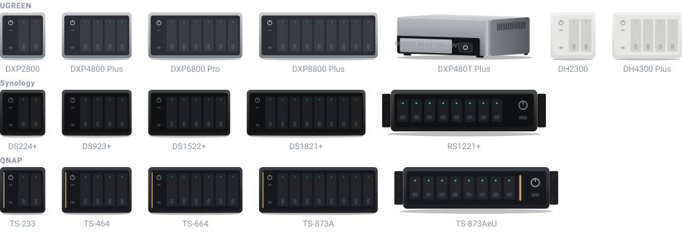

# ha-ugreen-nas-card

[](https://github.com/hacs/integration)
[](https://github.com/juju35/ha-ugreen-nas-card/actions/workflows/hacs.yml)
[](https://github.com/juju35/ha-ugreen-nas-card/actions/workflows/validate.yml)
[](https://github.com/juju35/ha-ugreen-nas-card/releases/latest)
[](LICENSE)

<p align="center"></p>

Lovelace cards for Home Assistant to monitor UGREEN NAS devices: CPU, RAM, temperatures, disks, RAID volumes and network at a glance.

The cards are built on top of the [UGREEN NAS integration](https://github.com/Tom-Bom-badil/home-assistant_ugreen-nas): entities are **discovered automatically**, you don't have to pick them one by one.

[](https://my.home-assistant.io/redirect/hacs_repository/?owner=juju35&repository=ha-ugreen-nas-card&category=plugin)

| UGREEN NAS Card | UGREEN NAS Mini Card |
|---|---|
|  |  |

## Features

- Two cards: a full **UGREEN NAS Card** and a compact **UGREEN NAS Mini Card**
- Zoom button at the top right of the mini card: it switches to the full card (gauges, network, volumes, disks and fans of the same NAS) and back; a click anywhere outside the card brings the compact view back
- Automatic discovery of the UGREEN NAS integration entities (several NAS supported)
- CPU, RAM and CPU temperature gauges, uptime and CPU model
- Network download / upload rates
- Volumes with RAID level, filesystem, status and used space
- Disks with model, status, temperature, size and power-on hours
- Fans speed (CPU fan and case fans)
- Colors turn orange / red when a threshold is crossed (CPU, RAM, temperatures, volume usage)
- Click any value to open its Home Assistant history (more-info dialog)
- Visual editor in the dashboard UI for both cards (no YAML needed)
- Light and dark mode, English and French
- UGREEN logo next to the NAS name, adapted to dark mode
- Single file, no external dependency, the NAS picture and logo are embedded

## Prerequisites

Home Assistant 2024.8 or later, and:

The [UGREEN NAS integration](https://github.com/Tom-Bom-badil/home-assistant_ugreen-nas) must be installed and configured (available in HACS).

## Installation

### Via HACS (recommended)

Click the button below to add the repository directly:

[](https://my.home-assistant.io/redirect/hacs_repository/?owner=juju35&repository=ha-ugreen-nas-card&category=plugin)

Then click **Download**, and reload your browser when HACS asks you to.

Or manually:

1. Open HACS → **⋮** (top right) → **Custom repositories**
2. Add `https://github.com/juju35/ha-ugreen-nas-card` — Type: **Dashboard**
3. Search for **UGREEN NAS Card** and click **Download**
4. Clear your browser cache and refresh

### Manual

1. Download `ugreen-nas-card.js` from the [latest release](https://github.com/juju35/ha-ugreen-nas-card/releases/latest)
2. Copy it to `/config/www/ugreen-nas-card.js`
3. Go to **Settings → Dashboards → ⋮ → Resources** → Add resource:
   - URL: `/local/ugreen-nas-card.js`
   - Type: **JavaScript Module**
4. Clear your browser cache and refresh

## Configuration

### Visual editor

Edit a dashboard, click **Add card** and search for **UGREEN NAS Card** or **UGREEN NAS Mini Card**. The NAS is preselected; pick another one in the list if you have several, set an optional title, choose the sections to display and the language. The preview updates live, and options left at their default are kept out of the generated YAML.

### Minimal

```yaml
type: custom:ugreen-nas-card
```

```yaml
type: custom:ugreen-nas-mini-card
```

### Full options

```yaml
type: custom:ugreen-nas-card
nas: ugreen_nas
title: My NAS
show_image: true
image: DXP4800 Plus
show_system: true
show_network: true
show_volumes: true
show_disks: true
show_fans: true
language: fr
```

```yaml
type: custom:ugreen-nas-mini-card
nas: ugreen_nas
title: My NAS
show_image: true
image: DXP4800 Plus
show_storage: true
show_network: true
zoom: true
language: fr
```

### Options reference

| Option | Card | Default | Description |
|---|---|---|---|
| `nas` | both | First NAS found | NAS to display: the `UGNAS_device_id` attribute of the integration entities (only needed with several NAS) |
| `title` | both | NAS name | Card title |
| `show_image` | both | `true` | Show the NAS picture |
| `image` | both | NAS model | Picture to show: a model name (`DXP2800`, `DXP4800 Plus`, `DXP480T Plus`, `DXP6800 Pro`, `DXP8800 Plus`, `DH2300`, `DH4300 Plus`…) or an image URL. By default the picture follows the model reported by the integration |
| `show_system` | full | `true` | CPU, RAM and temperature gauges, uptime, CPU model |
| `show_network` | both | `true` | Network download / upload |
| `show_volumes` | full | `true` | Volumes and used space |
| `show_disks` | full | `true` | Disks details |
| `show_fans` | full | `true` | Fans speed |
| `show_storage` | mini | `true` | Overall storage usage bar |
| `zoom` | mini | `true` | Zoom button at the top right: switches to the full card and back (`false` removes it) |
| `language` | both | Auto | Force language: `fr` or `en` (auto-detects from HA settings) |

## Screenshots

| Light | Dark (French) |
|---|---|
|  |  |
|  |  |
|  |  |

## How it works

Every entity created by the UGREEN NAS integration carries a `UGNAS_device_id` attribute. The cards use it to gather the entities of a NAS, then recognize each sensor from the end of its entity id (`cpu_usage`, `pool_1_volume_1_used_size_raw`, `pool_2_disk_1_temperature`…). Entity ids de-duplicated by Home Assistant (for example `sensor.ugreen_nas_cpu_usage_2`) are supported, and so are renamed devices.

Volume sizes are read from the `*_raw` sensors (bytes) so that the used space is exact whatever the unit chosen by the integration.

Thresholds:

| Value | Orange | Red |
|---|---|---|
| CPU usage | 70 % | 90 % |
| RAM usage | 80 % | 95 % |
| CPU temperature | 75 °C | 90 °C |
| Disk temperature | 60 °C | 70 °C |
| Volume usage | 80 % | 90 % |

## Development

```bash
npm install
npm run build        # bundles src/ugreen-nas-card.js into dist/ugreen-nas-card.js
npm run check        # builds and checks the card (run in CI)
npm run screenshots  # renders the cards with mock data (scripts/mock-states.mjs) into screenshots/
```

`dist/` is not committed: `npm run build` creates it locally, CI builds it on every push, and the release workflow attaches the built file to the release, which is where HACS downloads it from.

### Releasing

1. Bump `version` in `package.json`
2. Add a `## <version>` section at the top of [CHANGELOG.md](CHANGELOG.md)
3. Push to `main`: the **Release** workflow builds the card, creates the tag and the GitHub release with the changelog section as notes, and attaches `ugreen-nas-card.js`

## Translations

The cards auto-detect the language from your Home Assistant settings. Currently supported:

| Language | Code |
|---|---|
| English | `en` |
| Français | `fr` |

Contributions for additional languages are welcome!

## License

[MIT](LICENSE)
