# ha-nas-card

[](https://www.home-assistant.io/integrations/marketplace/)
[](https://github.com/juju35/ha-nas-card/actions/workflows/hacs.yml)
[](https://github.com/juju35/ha-nas-card/actions/workflows/validate.yml)
[](https://github.com/juju35/ha-nas-card/actions/workflows/lint.yml)
[](https://github.com/juju35/ha-nas-card/releases/latest)
[](https://github.com/juju35/ha-nas-card/blob/main/LICENSE)
[](https://buymeacoffee.com/julienstep9)

<p align="center">
  &nbsp;&nbsp;
  &nbsp;&nbsp;
  
</p>

Lovelace cards for Home Assistant to monitor NAS devices — [UGREEN](https://nas.ugreen.com), [Synology](https://www.synology.com) and [QNAP](https://www.qnap.com): CPU, RAM, temperatures, disks, RAID volumes and network at a glance.

The cards are built on top of the [UGREEN NAS integration](https://github.com/Tom-Bom-badil/home-assistant_ugreen-nas), and of the [Synology DSM](https://www.home-assistant.io/integrations/synology_dsm/) and [QNAP](https://www.home-assistant.io/integrations/qnap/) integrations included in Home Assistant: entities are **discovered automatically**, you don't have to pick them one by one, and it works whatever your Home Assistant language.

[](https://my.home-assistant.io/redirect/marketplace_repository/?owner=juju35&repository=ha-nas-card&category=plugin)

|  UGREEN |  Synology |  QNAP |
|---|---|---|
| <picture><source media="(prefers-color-scheme: dark)" srcset="https://raw.githubusercontent.com/juju35/ha-nas-card/main/screenshots/card-dark.png">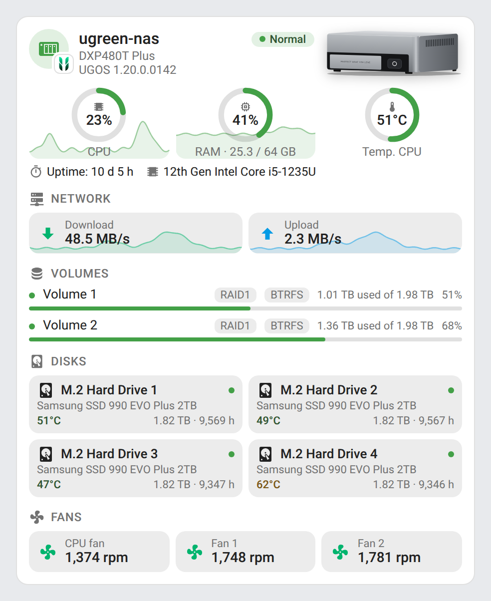</picture> | <picture><source media="(prefers-color-scheme: dark)" srcset="https://raw.githubusercontent.com/juju35/ha-nas-card/main/screenshots/card-synology-dark.png">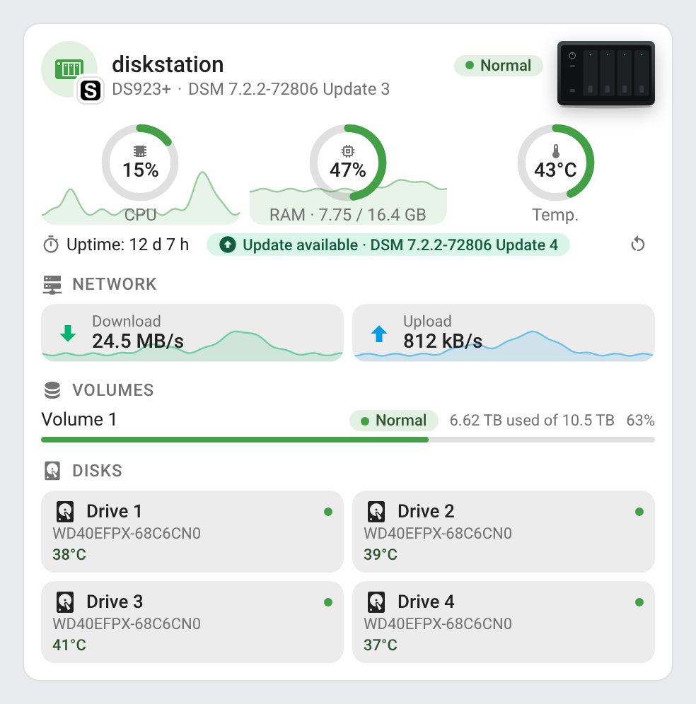</picture> | <picture><source media="(prefers-color-scheme: dark)" srcset="https://raw.githubusercontent.com/juju35/ha-nas-card/main/screenshots/card-qnap-dark.png">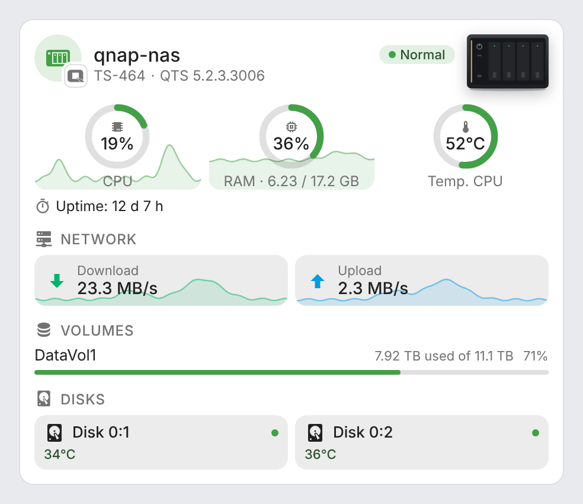</picture> |
| <picture><source media="(prefers-color-scheme: dark)" srcset="https://raw.githubusercontent.com/juju35/ha-nas-card/main/screenshots/mini-card-dark.png">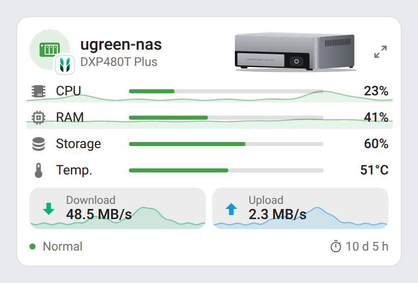</picture> | <picture><source media="(prefers-color-scheme: dark)" srcset="https://raw.githubusercontent.com/juju35/ha-nas-card/main/screenshots/mini-card-synology-dark.png">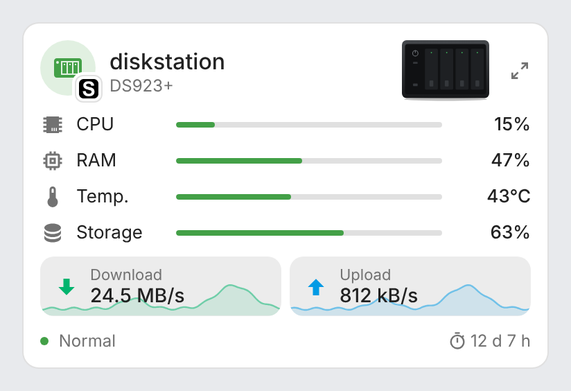</picture> | <picture><source media="(prefers-color-scheme: dark)" srcset="https://raw.githubusercontent.com/juju35/ha-nas-card/main/screenshots/mini-card-qnap-dark.png">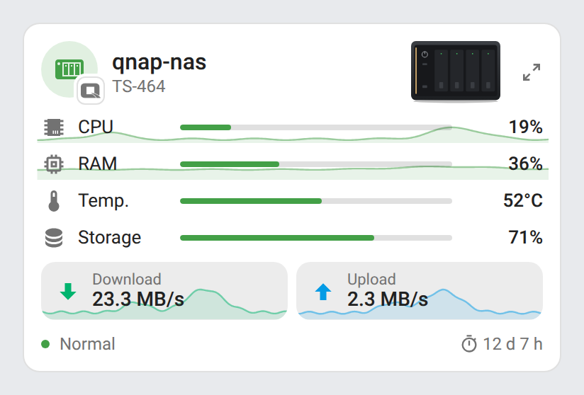</picture> |

## Features

- Two cards: a full **NAS Card** and a compact **NAS Mini Card**, of type `custom:nas-card` and `custom:nas-mini-card` (the former types `custom:ugreen-nas-card` and `custom:ugreen-nas-mini-card` keep working)
- Three integrations: **UGREEN NAS**, **Synology DSM** and **QNAP** — automatic discovery, several NAS supported, brands can be mixed
- CPU, RAM and temperature gauges, uptime and CPU model
- Network download / upload rates, with their last 24 hours drawn behind each tile, on the full card and the mini card (recorder statistics)
- Volumes with RAID level, filesystem, status and used space
- Disks with model, status, temperature, size and power-on hours; the status dot turns red on any disk problem (on Synology also the SMART status and the bad sector / remaining life thresholds); a volume or disk without status entity has no dot
- Synology: an « Update available » chip when DSM has an update (click for its more-info dialog), and a reboot button at the end of the system facts, with a confirmation popup at the top of the card
- Fans speed (CPU fan and case fans, UGREEN)
- Status pill: the server status (UGREEN, QNAP) or the security status (Synology)
- Colors turn orange / red when a threshold is crossed (CPU, RAM, temperatures, volume usage)
- Detail button on the mini card (top right): it switches the mini card to the full card's content and back; a click anywhere outside the card brings the compact view back
- Click any value to open its Home Assistant history (more-info dialog)
- Round NAS icon next to the NAS name, in the status color (green when the NAS is normal, orange on a warning, grey when the status is unavailable), with the brand logo (UGREEN, Synology or QNAP) as a badge: a click opens the brand's website
- Click the NAS picture to open the NAS web interface (UGOS, DSM, QTS), found automatically from Home Assistant for UGREEN and Synology; both addresses can be changed in the visual editor
- Drawn NAS picture that follows the model: 43 models drawn across the three brands — towers by bay count, all-flash DXP480T, rackmounts (see [Screenshots](#screenshots)) — or your own picture
- Visual editor in the dashboard UI for both cards (no YAML needed), with the pictures listed by brand
- Light and dark mode, English, French, German, Spanish, Serbian (Cyrillic and Latin), Italian, Dutch, European Portuguese, Polish, Romanian, Danish, Swedish, Bulgarian, Russian, Ukrainian, Hungarian, Slovak, Czech, Slovenian, Latvian and Greek
- Single file, no external dependency: the NAS pictures are embedded

> **Moved**: this repository was `juju35/ha-ugreen-nas-card`. GitHub redirects the old address, but if you added it to the Marketplace from a link, remove it and add `https://github.com/juju35/ha-nas-card` instead.

## Supported integrations

| Integration | NAS | What the cards show |
|---|---|---|
| [UGREEN NAS](https://github.com/Tom-Bom-badil/home-assistant_ugreen-nas) (Marketplace) | UGREEN DXP and DH | Everything: CPU, RAM, temperatures, network, volumes, disks, **fans**, server status, link to UGOS |
| [Synology DSM](https://www.home-assistant.io/integrations/synology_dsm/) (built in) | Synology | CPU, RAM, temperature, network, volumes, disks (status, SMART, bad sectors, remaining life), security status, DSM version and update, reboot, link to DSM; no fans |
| [QNAP](https://www.home-assistant.io/integrations/qnap/) (built in) | QNAP | CPU, RAM, temperature, network, volumes, drives, server status, QTS / QuTS hero firmware; no fans |

Several NAS are supported, and brands can be mixed. Some sensors of the Synology DSM and QNAP integrations are disabled by default, see [How it works](#how-it-works).

## Prerequisites

Home Assistant 2024.8 or later, and at least one of:

- the [UGREEN NAS integration](https://github.com/Tom-Bom-badil/home-assistant_ugreen-nas) (available in the Marketplace)
- the [Synology DSM integration](https://www.home-assistant.io/integrations/synology_dsm/) (included in Home Assistant)
- the [QNAP integration](https://www.home-assistant.io/integrations/qnap/) (included in Home Assistant)

## Installation

### Via the Marketplace (recommended)

Click the button below to add the repository directly:

[](https://my.home-assistant.io/redirect/marketplace_repository/?owner=juju35&repository=ha-nas-card&category=plugin)

Then click **Install**, and reload your browser when the Marketplace asks you to.

Or manually:

1. Open **Settings → Marketplace → Add from link** (top right; this needs a GitHub account connected)
2. Add `https://github.com/juju35/ha-nas-card` — Type: **Dashboard**
3. Open **NAS Card** and click **Install**
4. Clear your browser cache and refresh

### Manual

1. Download `nas-card.js` from the [latest release](https://github.com/juju35/ha-nas-card/releases/latest)
2. Copy it to `/config/www/nas-card.js`
3. Go to **Settings → Dashboards → ⋮ → Resources** → Add resource:
   - URL: `/local/nas-card.js`
   - Type: **JavaScript Module**
4. Clear your browser cache and refresh

## Configuration

### Visual editor

Edit a dashboard, click **Add card** and search for **NAS Card** or **NAS Mini Card**. The first NAS found is preselected; pick another one in the list if you have several (UGREEN, Synology and QNAP NAS are listed together), set an optional title, choose the picture (listed by brand: « QNAP TS-464 », « Synology DS923+ », « UGREEN DXP4800 Plus »…), the sections to display and the language. The preview updates live, and options left at their default are kept out of the generated YAML.

### Minimal

```yaml
type: custom:nas-card
```

```yaml
type: custom:nas-mini-card
```

### Full options

```yaml
type: custom:nas-card
nas: ugreen_nas
title: My NAS
show_image: true
image: DXP4800 Plus
url: http://192.168.1.10:9999
brand_url: https://nas.ugreen.com
show_system: true
show_network: true
show_volumes: true
show_disks: true
show_fans: true
thresholds:
  cpu:
    warning: 60
    critical: 85
  volume:
    critical: 95
language: fr
```

```yaml
type: custom:nas-mini-card
nas: ugreen_nas
title: My NAS
show_image: true
image: DS923+
show_storage: true
show_network: true
zoom: true
language: fr
```

### Options reference

| Option | Card | Default | Description |
|---|---|---|---|
| `nas` | both | First NAS found | NAS to display (only needed with several NAS): the `UGNAS_device_id` attribute for UGREEN, the NAS device id for Synology DSM and QNAP — pick it in the visual editor |
| `title` | both | NAS name | Card title |
| `show_image` | both | `true` | Show the NAS picture |
| `image` | both | NAS model | Picture to show: a model name (`DXP4800 Plus`, `DXP480T Plus`, `DH4300 Plus`, `DS923+`, `DS1821+`, `RS822+`, `TS-464`, `TVS-h674`, `TS-873AeU`… — see the [drawn models](#screenshots)) or an image URL (e.g. `/local/my-nas.png`). By default the picture follows the model reported by the integration; an unknown model of a known family is drawn from its bay count |
| `url` | both | Device configuration URL | Web interface of the NAS, opened by a click on the NAS picture. By default the configuration URL of the NAS device in Home Assistant (the « Visit » link of the device page), set by the UGREEN NAS and Synology DSM integrations; the QNAP integration has none, so set it for a QNAP NAS (e.g. `http://192.168.1.10:8080`) |
| `brand_url` | both | Brand website | Website opened by a click on the header icon: [nas.ugreen.com](https://nas.ugreen.com), [synology.com](https://www.synology.com) or [qnap.com](https://www.qnap.com) by default |
| `show_system` | full | `true` | CPU, RAM and temperature gauges, uptime, CPU model |
| `show_network` | both | `true` | Network download / upload |
| `show_history` | both | `true` | 24 h curve behind the download / upload tiles (on the mini card, the rates then show as tiles above the footer instead of in it), from the recorder's 5-minute statistics (needs rate sensors with a `state_class`, the case for the three integrations). Points sit at their time over the last 24 hours, and the curve breaks where data is missing |
| `show_volumes` | full | `true` | Volumes and used space |
| `show_disks` | full | `true` | Disks details |
| `show_fans` | full | `true` | Fans speed |
| `show_storage` | mini | `true` | Overall storage usage bar |
| `zoom` | mini | `true` | Detail button at the top right: switches to the full card and back (`false` removes it) |
| `thresholds` | both | See [Thresholds](#thresholds) | Orange (`warning`) and red (`critical`) levels per reading: `cpu`, `ram`, `temperature` (CPU / system), `disk_temperature` and `volume` (volumes, and the mini card storage bar); set only the values to change |
| `language` | both | Auto | Force language: `en`, `fr`, `de`, `es`, `sr`, `sr-Latn`, `it`, `nl`, `pt`, `pl`, `ro`, `da`, `sv`, `bg`, `ru`, `uk`, `hu`, `sk`, `cs`, `sl`, `lv` or `el` (auto-detects from HA settings) |

## Screenshots

###  UGREEN

While the NAS is running, the card animates: the cooling fans spin at their live speed. It settles to a still card when they stop (and honours `prefers-reduced-motion`).

| Light | Dark |
|---|---|
| 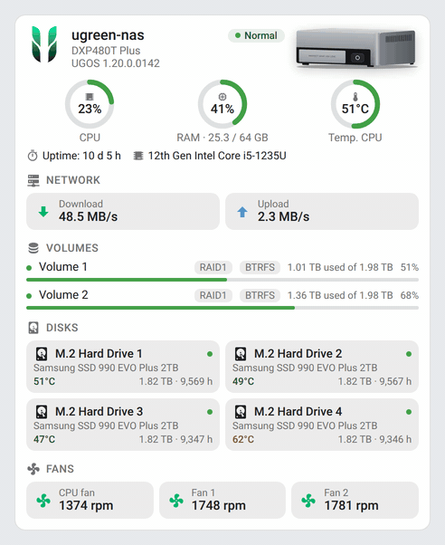 | 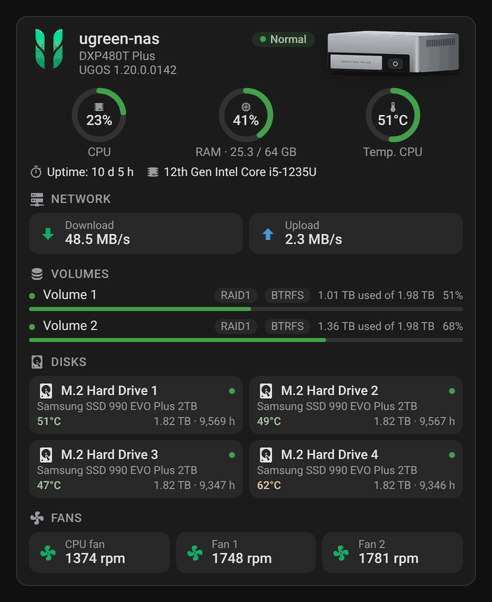 |

| Light | Dark |
|---|---|
|  | 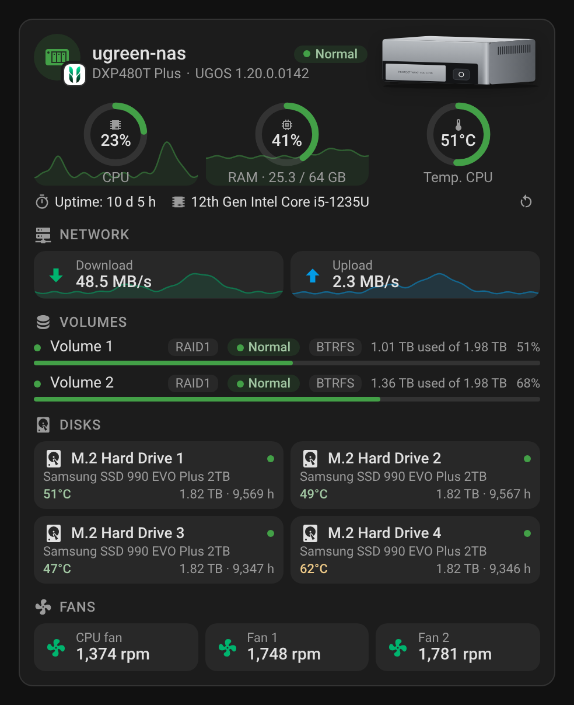 |
|  | 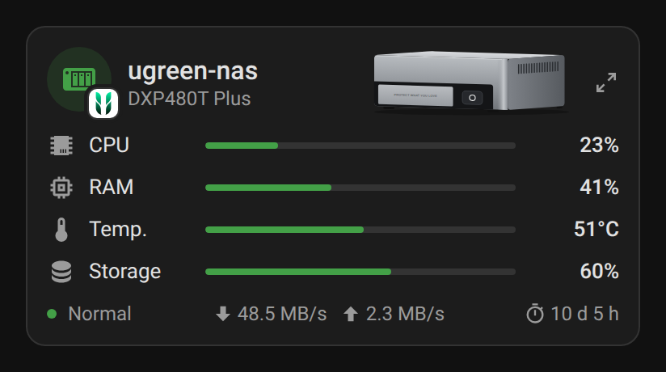 |

Mini card zoomed in with its detail button (top right, click it again or anywhere outside the card to go back):

| Light | Dark |
|---|---|
| 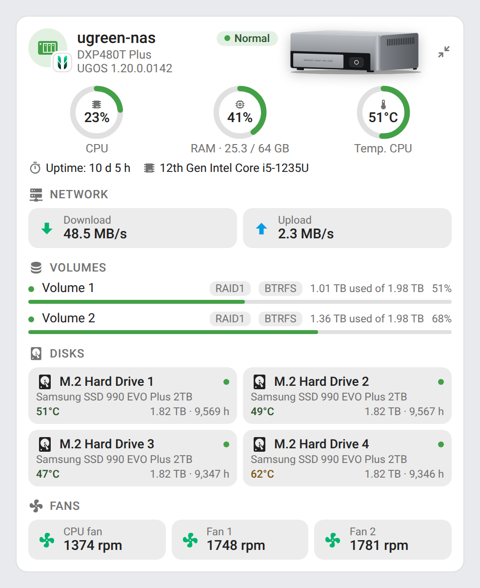 | 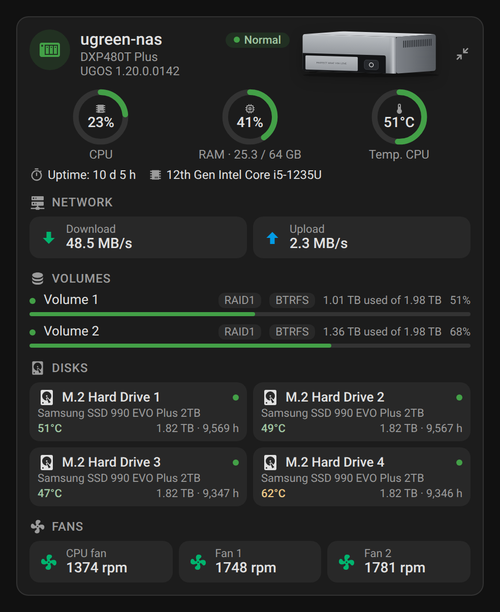 |

Drawn UGREEN models (aluminium DXP series, white DH series, flat all-flash DXP480T):

<p align="center">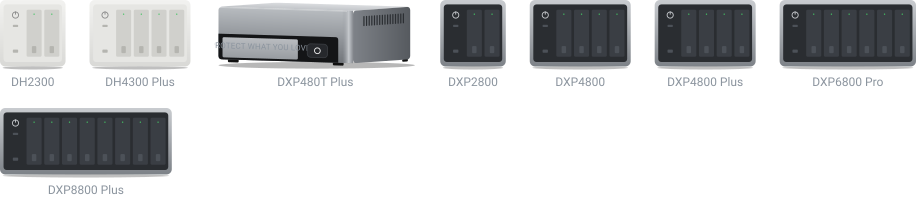</p>

###  Synology

DS923+ set up with Synology DSM: the volume and the drives come from the NAS child devices, the pill shows the security status.

| Light | Dark |
|---|---|
|  | 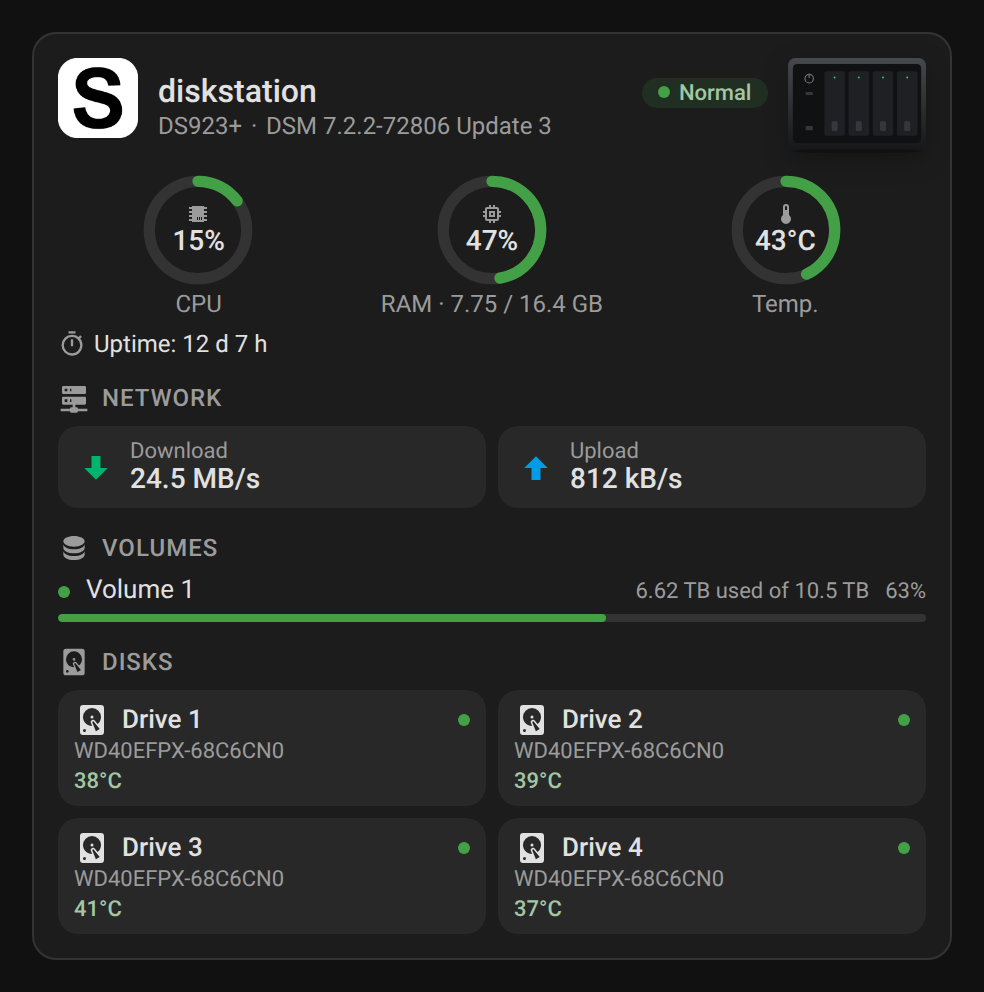 |
|  | 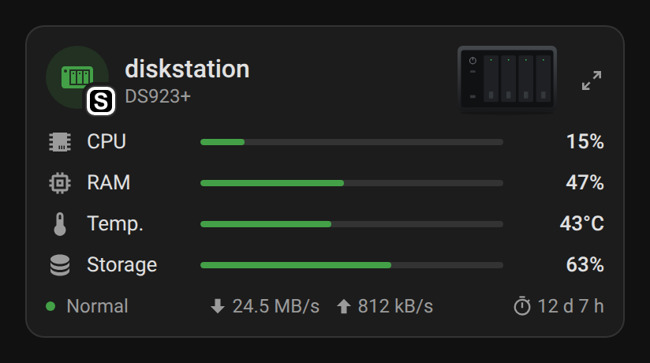 |

Drawn Synology models (black DS towers, RS rackmounts):

<p align="center">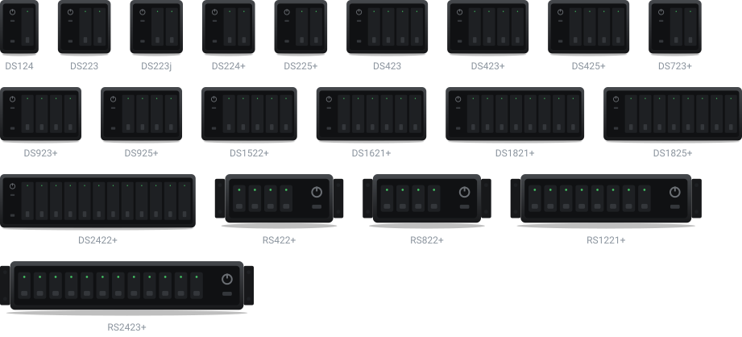</p>

###  QNAP

TS-464 set up with QNAP, with the drive temperatures and the volume used space enabled:

| Light | Dark |
|---|---|
|  | 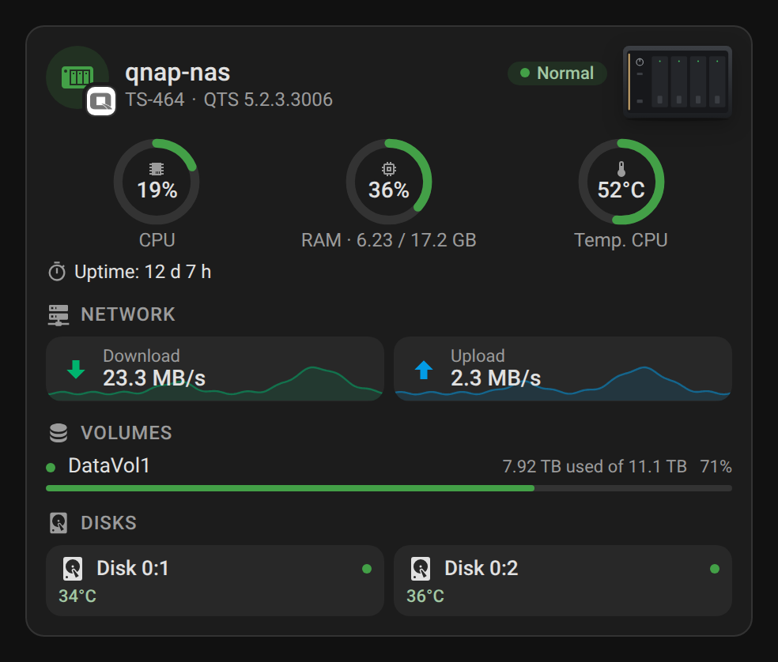 |
|  | 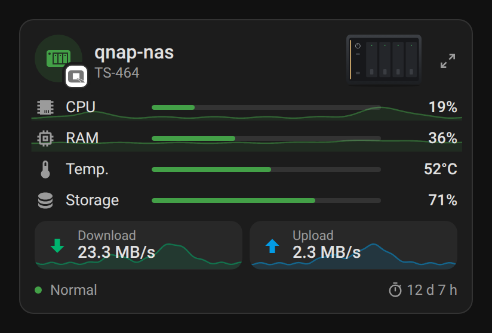 |

Drawn QNAP models (graphite towers with the copper strip, rackmounts for the models ending in U):

<p align="center">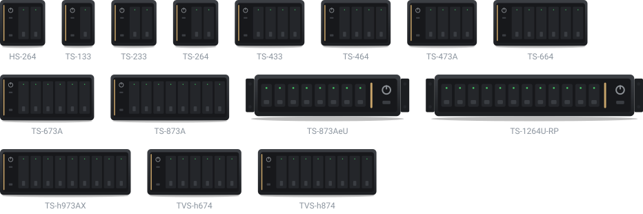</p>

## How it works

### UGREEN NAS

Every entity created by the integration carries a `UGNAS_device_id` attribute. The cards use it to gather the entities of a NAS, then recognize each sensor from the end of its entity id (`cpu_usage`, `pool_1_volume_1_used_size_raw`, `pool_2_disk_1_temperature`…). Entity ids de-duplicated by Home Assistant (for example `sensor.ugreen_nas_cpu_usage_2`) are supported, and so are renamed devices. Volume sizes are read from the `*_raw` sensors (bytes) so that the used space is exact whatever the unit chosen by the integration.

### Synology DSM and QNAP

The cards read the Home Assistant entity and device registries instead of entity ids: every entity of these integrations is matched by its `translation_key` (`cpu_total_load`, `memory_real_usage`, `volume_percentage_used`, `disk_temp`, `drive_temp`…) and by the device it belongs to. Entity ids can therefore be in any language or renamed without breaking the cards.

- **Synology DSM**: volumes and disks are child devices of the NAS; their labels and the disk models come from there. The security status binary sensor feeds the status pill (« Normal » / « Warning »), and the uptime comes from the **Last boot** sensor. The DSM version is shown under the model. A disk is shown in red when its status or SMART status is not normal, or when its **Exceeded max bad sectors** or **Below min remaining life** binary sensor is on. The DSM **update** entity of the NAS shows an « Update available » chip with the new version while it is on, and the **Reboot** button (found by its `restart` device class, the shutdown button is never used) adds a reboot button at the end of the system facts: it asks for a confirmation at the top of the card before pressing it.
- **QNAP**: everything sits on one device; volumes and drives are told apart by the identifier the integration inserts in the entity names (for example `DataVol1` or `0:1`). The first network interface feeds the network tiles, and the firmware is shown as QTS or QuTS hero.
- Some useful sensors are disabled by default by these integrations — on QNAP, drive temperatures, SMART statuses, memory sizes, network rates and volume used space; on Synology, total volume sizes. Enable them in **Settings → Devices & services → Entities** to fill the matching sections of the card (missing sizes are completed from the used percentage when possible).
- Fans are not reported by these integrations: the fans section only shows on UGREEN NAS.

### NAS pictures

The picture is drawn from the model reported by the integration, so a renamed NAS keeps the right picture: UGREEN DXP towers (aluminium) and DH towers (white) by bay count, the flat all-flash DXP480T; Synology DS towers with the bay count of their family (DS723+ has 2 bays, DS923+ 4, DS1522+ 5, DS1821+ 8…) and RS rackmounts; QNAP towers with the bay count of their name (TS-464 → 4) and rackmounts for the models ending in U (TS-873AeU, TS-1264U-RP). Use the `image` option to pick another one or your own.

### Units

Sizes and rates follow Home Assistant's units: `kB`, `MB`, `GB` and `TB` (and `kB/s`, `MB/s`…) are decimal (powers of 1000), `KiB`, `MiB`, `GiB` and `TiB` (and `KiB/s`, `MiB/s`…) are binary (powers of 1024), whatever unit you choose for a sensor in Home Assistant. The cards display decimal units, so a volume reported as `6.62 TB` reads `6.62 TB` on the card too.

### Thresholds

Default levels, changed with the `thresholds` option (or the **Alert thresholds** section of the visual editor):

| Value | Key | Orange (`warning`) | Red (`critical`) |
|---|---|---|---|
| CPU usage | `cpu` | 70 % | 90 % |
| RAM usage | `ram` | 80 % | 95 % |
| CPU / system temperature | `temperature` | 75 °C | 90 °C |
| Disk temperature | `disk_temperature` | 60 °C | 70 °C |
| Volume usage | `volume` | 80 % | 90 % |

```yaml
thresholds:
  temperature:
    warning: 70
  disk_temperature:
    warning: 50
    critical: 60
```

Temperatures are shown in the unit of their sensor, which follows your Home Assistant unit system (°C, °F or K); the temperature thresholds are in °C and apply to the converted value, so 124 °F (51 °C) stays green.

### Narrow cards

The full card fits down to 9 columns of a sections view (about 234 px on a phone), the mini card down to 6 columns (about 156 px on a phone). On narrow cards, the NAS picture is hidden (below about 340 px on the full card, 220 px on the mini card) so that the name keeps its room, the volume details move under their bar and the mini card drops the uptime from its footer, then puts its upload rate under the download rate. Below about 200 px, the status pill shrinks to its colored dot (its text stays in its tooltip) and the mini card rows keep their icon, bar and value (the label stays in their tooltip). In a container sized by its content (a grid `auto` column, an inline-block wrapper), the cards take a width of 400 px instead of collapsing.

## Development

```bash
npm install
npm run build              # bundles src/nas-card.js into dist/nas-card.js
npm run check              # builds and checks the card (run in CI)
node scripts/models-svg.mjs  # renders the drawn model galleries of the README into images/models-*.svg
npm run screenshots        # renders the cards with mock data (scripts/mock-states.mjs) into screenshots/ (and fans.gif / fans-dark.gif, needs ffmpeg)
```

`dist/` is not committed: `npm run build` creates it locally, CI builds it on every push, and the release workflow attaches the built file to the release, which is where the Marketplace installs it from.

### Releasing

1. Bump `version` in `package.json`
2. Add a `## <version>` section at the top of [CHANGELOG.md](https://github.com/juju35/ha-nas-card/blob/main/CHANGELOG.md)
3. Push to `main`: the **Release** workflow builds the card, creates the tag and the GitHub release with the changelog section as notes, and attaches `nas-card.js`

## Translations

The cards auto-detect the language from your Home Assistant settings. Currently supported:

| Language | Code |
|---|---|
| English | `en` |
| Français | `fr` |
| Deutsch | `de` |
| Español | `es` |
| Српски (Serbian, Cyrillic) | `sr` |
| Srpski (Serbian, Latin) | `sr-Latn` |
| Italiano | `it` |
| Nederlands | `nl` |
| Português (Portugal) | `pt` |
| Polski | `pl` |
| Română | `ro` |
| Dansk | `da` |
| Svenska | `sv` |
| Български | `bg` |
| Русский | `ru` |
| Українська | `uk` |
| Magyar | `hu` |
| Slovenčina | `sk` |
| Čeština | `cs` |
| Slovenščina | `sl` |
| Latviešu | `lv` |
| Ελληνικά | `el` |

Contributions for additional languages are welcome!

## Credits

UGREEN and its logo are trademarks of UGREEN Group; Synology, DSM and the Synology logo are trademarks of Synology Inc.; QNAP, QTS, QuTS hero and the QNAP logo are trademarks of QNAP Systems, Inc.. The NAS pictures are drawings, not product photos. This project is not affiliated with UGREEN, Synology or QNAP.

## License

[MIT](https://github.com/juju35/ha-nas-card/blob/main/LICENSE)

## Support

If you find this project useful, you can support its development:

<a href="https://buymeacoffee.com/julienstep9"></a>
