# ha-nas-card

[](https://github.com/hacs/integration)
[](https://github.com/juju35/ha-nas-card/actions/workflows/hacs.yml)
[](https://github.com/juju35/ha-nas-card/actions/workflows/validate.yml)
[](https://github.com/juju35/ha-nas-card/releases/latest)
[](LICENSE)

<p align="center">
  &nbsp;&nbsp;
  &nbsp;&nbsp;
  
</p>

Lovelace cards for Home Assistant to monitor NAS devices — [UGREEN](https://nas.ugreen.com), [Synology](https://www.synology.com) and [QNAP](https://www.qnap.com): CPU, RAM, temperatures, disks, RAID volumes and network at a glance.

The cards are built on top of the [UGREEN NAS integration](https://github.com/Tom-Bom-badil/home-assistant_ugreen-nas), and of the [Synology DSM](https://www.home-assistant.io/integrations/synology_dsm/) and [QNAP](https://www.home-assistant.io/integrations/qnap/) integrations included in Home Assistant: entities are **discovered automatically**, you don't have to pick them one by one, and it works whatever your Home Assistant language.

[](https://my.home-assistant.io/redirect/hacs_repository/?owner=juju35&repository=ha-nas-card&category=plugin)

|  UGREEN |  Synology |  QNAP |
|---|---|---|
|  |  |  |
|  |  |  |

## Features

- Two cards: a full **NAS Card** and a compact **NAS Mini Card**, of type `custom:nas-card` and `custom:nas-mini-card` (the former types `custom:ugreen-nas-card` and `custom:ugreen-nas-mini-card` keep working)
- Three integrations: **UGREEN NAS**, **Synology DSM** and **QNAP** — automatic discovery, several NAS supported, brands can be mixed
- CPU, RAM and temperature gauges, uptime and CPU model
- Network download / upload rates
- Volumes with RAID level, filesystem, status and used space
- Disks with model, status, temperature, size and power-on hours
- Fans speed (CPU fan and case fans, UGREEN)
- Status pill: the server status (UGREEN, QNAP) or the security status (Synology)
- Colors turn orange / red when a threshold is crossed (CPU, RAM, temperatures, volume usage)
- Detail button on the mini card (top right): it switches the mini card to the full card's content and back; a click anywhere outside the card brings the compact view back
- Click any value to open its Home Assistant history (more-info dialog)
- Brand logo next to the NAS name (UGREEN, Synology or QNAP), adapted to dark mode
- Drawn NAS picture that follows the model: 43 models drawn across the three brands — towers by bay count, all-flash DXP480T, rackmounts (see [Screenshots](#screenshots)) — or your own picture
- Visual editor in the dashboard UI for both cards (no YAML needed), with the pictures listed by brand
- Light and dark mode, English and French
- Single file, no external dependency: the NAS pictures and the UGREEN logo are embedded, the Synology and QNAP logos load from the [Home Assistant brand images](https://brands.home-assistant.io) (the ones the Home Assistant interface itself shows)

> **Moved**: this repository was `juju35/ha-ugreen-nas-card`. GitHub redirects the old address, but if you added it to HACS as a custom repository, remove it and add `https://github.com/juju35/ha-nas-card` instead.

## Prerequisites

Home Assistant 2024.8 or later, and at least one of:

- the [UGREEN NAS integration](https://github.com/Tom-Bom-badil/home-assistant_ugreen-nas) (available in HACS)
- the [Synology DSM integration](https://www.home-assistant.io/integrations/synology_dsm/) (included in Home Assistant)
- the [QNAP integration](https://www.home-assistant.io/integrations/qnap/) (included in Home Assistant)

## Installation

### Via HACS (recommended)

Click the button below to add the repository directly:

[](https://my.home-assistant.io/redirect/hacs_repository/?owner=juju35&repository=ha-nas-card&category=plugin)

Then click **Download**, and reload your browser when HACS asks you to.

Or manually:

1. Open HACS → **⋮** (top right) → **Custom repositories**
2. Add `https://github.com/juju35/ha-nas-card` — Type: **Dashboard**
3. Search for **NAS Card** and click **Download**
4. Clear your browser cache and refresh

### Manual

1. Download `nas-card.js` from the [latest release](https://github.com/juju35/ha-nas-card/releases/latest)
2. Copy it to `/config/www/nas-card.js`
3. Go to **Settings → Dashboards → ⋮ → Resources** → Add resource:
   - URL: `/local/nas-card.js`
   - Type: **JavaScript Module**
4. Clear your browser cache and refresh

## Configuration

### Visual editor

Edit a dashboard, click **Add card** and search for **NAS Card** or **NAS Mini Card**. The first NAS found is preselected; pick another one in the list if you have several (UGREEN, Synology and QNAP NAS are listed together), set an optional title, choose the picture (listed by brand: « QNAP TS-464 », « Synology DS923+ », « UGREEN DXP4800 Plus »…), the sections to display and the language. The preview updates live, and options left at their default are kept out of the generated YAML.

### Minimal

```yaml
type: custom:nas-card
```

```yaml
type: custom:nas-mini-card
```

### Full options

```yaml
type: custom:nas-card
nas: ugreen_nas
title: My NAS
show_image: true
image: DXP4800 Plus
show_system: true
show_network: true
show_volumes: true
show_disks: true
show_fans: true
language: fr
```

```yaml
type: custom:nas-mini-card
nas: ugreen_nas
title: My NAS
show_image: true
image: DS923+
show_storage: true
show_network: true
zoom: true
language: fr
```

### Options reference

| Option | Card | Default | Description |
|---|---|---|---|
| `nas` | both | First NAS found | NAS to display (only needed with several NAS): the `UGNAS_device_id` attribute for UGREEN, the NAS device id for Synology DSM and QNAP — pick it in the visual editor |
| `title` | both | NAS name | Card title |
| `show_image` | both | `true` | Show the NAS picture |
| `image` | both | NAS model | Picture to show: a model name (`DXP4800 Plus`, `DXP480T Plus`, `DH4300 Plus`, `DS923+`, `DS1821+`, `RS822+`, `TS-464`, `TVS-h674`, `TS-873AeU`… — see the [drawn models](#screenshots)) or an image URL (e.g. `/local/my-nas.png`). By default the picture follows the model reported by the integration; an unknown model of a known family is drawn from its bay count |
| `show_system` | full | `true` | CPU, RAM and temperature gauges, uptime, CPU model |
| `show_network` | both | `true` | Network download / upload |
| `show_volumes` | full | `true` | Volumes and used space |
| `show_disks` | full | `true` | Disks details |
| `show_fans` | full | `true` | Fans speed |
| `show_storage` | mini | `true` | Overall storage usage bar |
| `zoom` | mini | `true` | Detail button at the top right: switches to the full card and back (`false` removes it) |
| `language` | both | Auto | Force language: `fr` or `en` (auto-detects from HA settings) |

## Screenshots

###  UGREEN

While the NAS is running, the card animates: the cooling fans spin at their live speed. It settles to a still card when they stop (and honours `prefers-reduced-motion`).

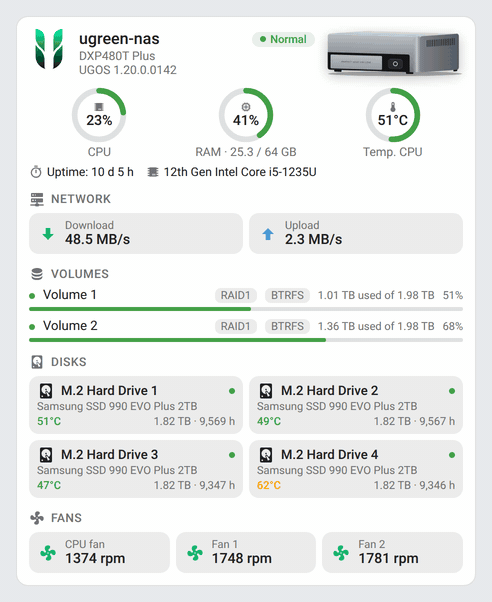

| Light | Dark |
|---|---|
| 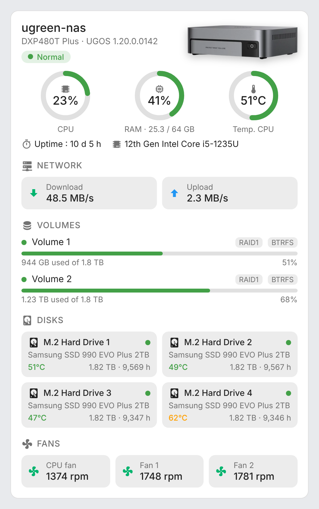 | 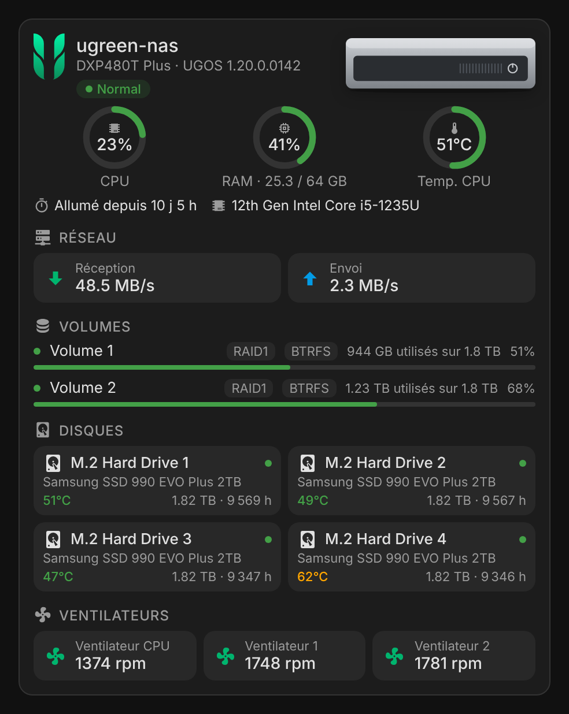 |
| 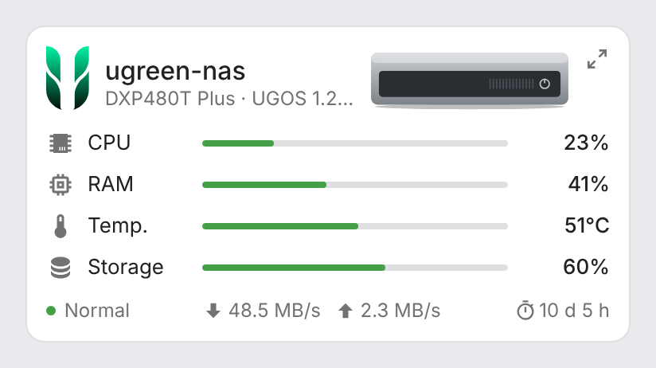 | 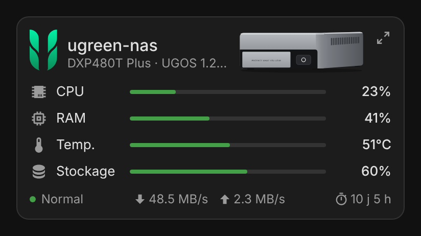 |

Mini card zoomed in with its detail button (top right, click it again or anywhere outside the card to go back):

| Light | Dark |
|---|---|
| 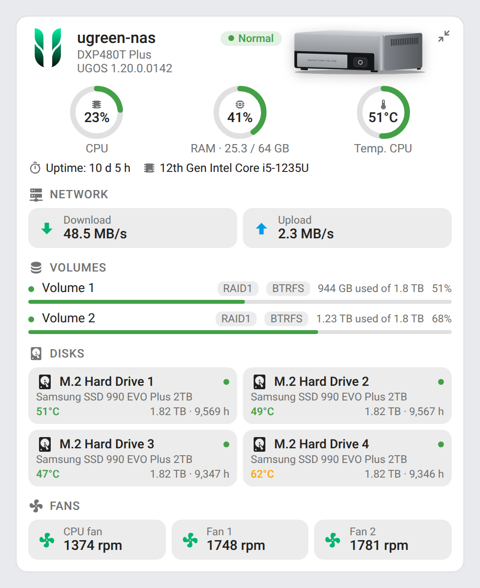 | 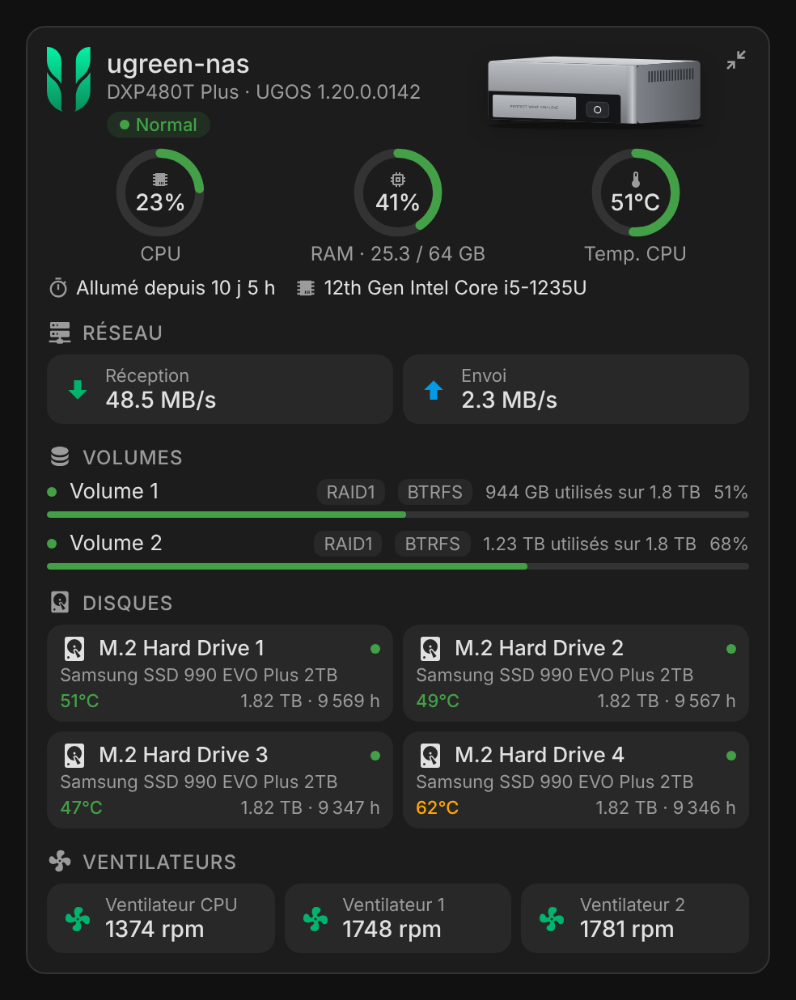 |

Drawn UGREEN models (aluminium DXP series, white DH series, flat all-flash DXP480T):

<p align="center">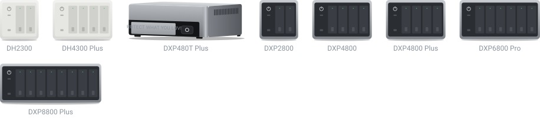</p>

###  Synology

DS923+ set up with Synology DSM: the volume and the drives come from the NAS child devices, the pill shows the security status.

| Light | Dark |
|---|---|
| 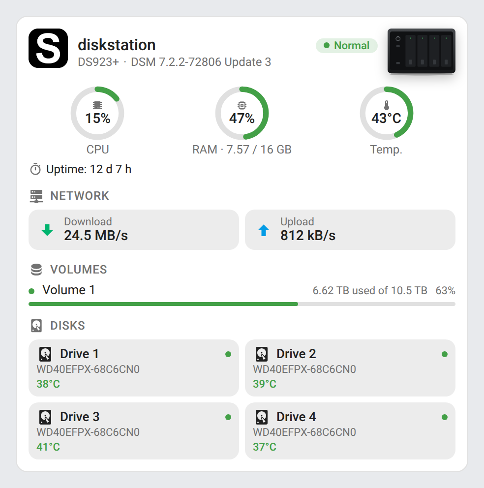 | 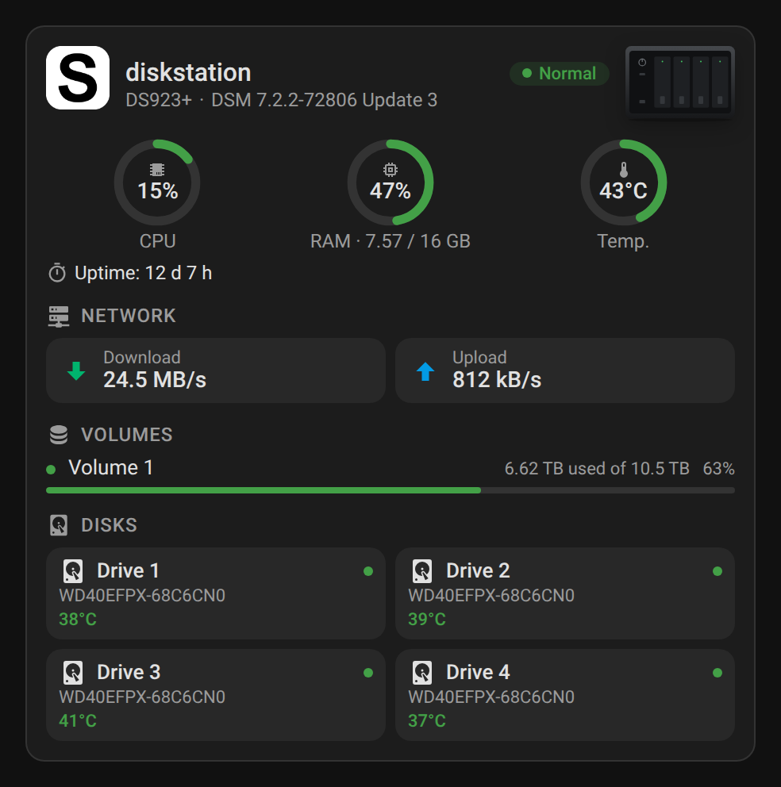 |
| 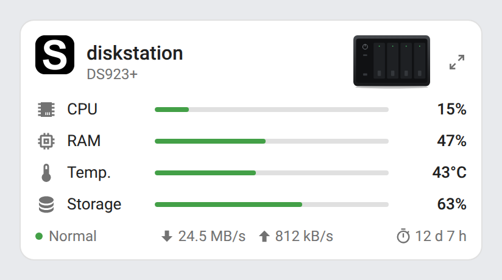 | |

Drawn Synology models (black DS towers, RS rackmounts):

<p align="center">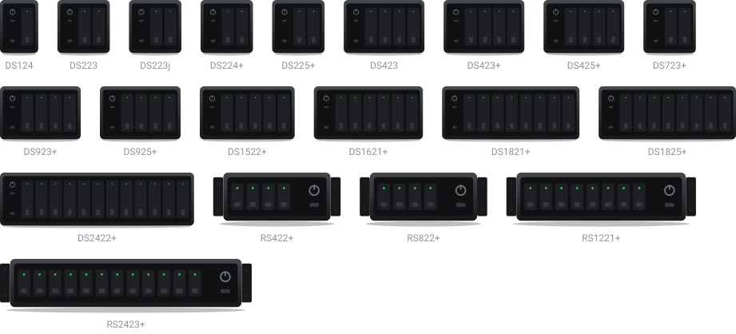</p>

###  QNAP

TS-464 set up with QNAP, with the drive temperatures and the volume used space enabled:

| Light | Dark |
|---|---|
| 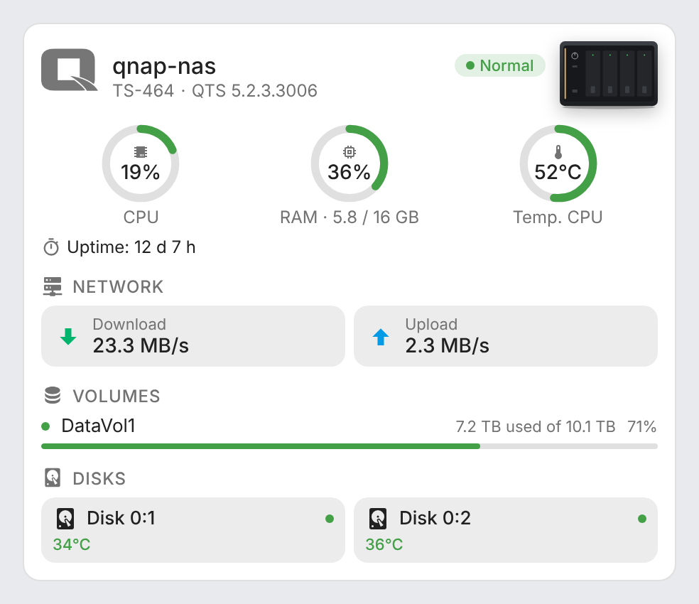 | 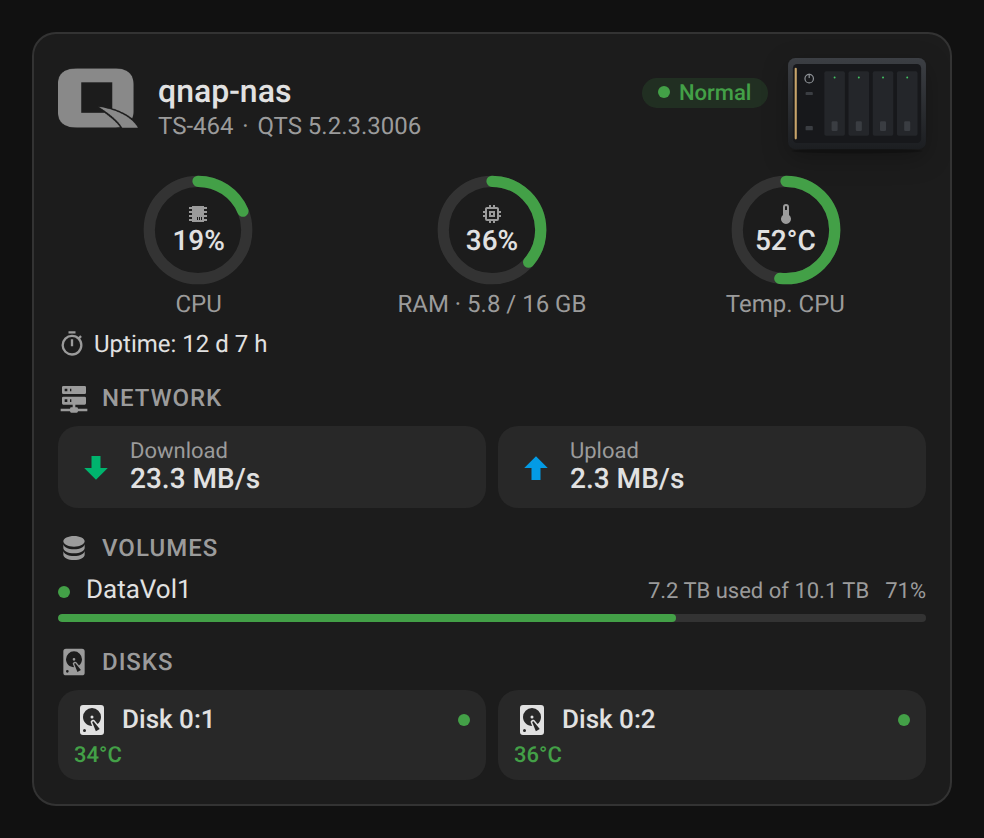 |
|  | |

Drawn QNAP models (graphite towers with the copper strip, rackmounts for the models ending in U):

<p align="center">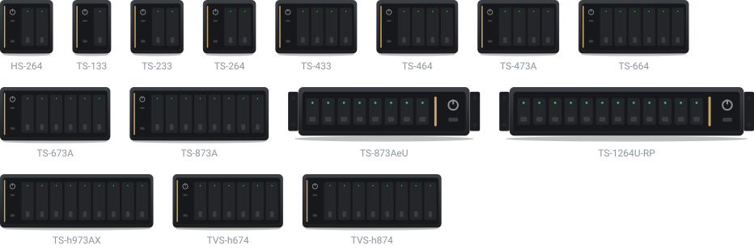</p>

## How it works

### UGREEN NAS

Every entity created by the integration carries a `UGNAS_device_id` attribute. The cards use it to gather the entities of a NAS, then recognize each sensor from the end of its entity id (`cpu_usage`, `pool_1_volume_1_used_size_raw`, `pool_2_disk_1_temperature`…). Entity ids de-duplicated by Home Assistant (for example `sensor.ugreen_nas_cpu_usage_2`) are supported, and so are renamed devices. Volume sizes are read from the `*_raw` sensors (bytes) so that the used space is exact whatever the unit chosen by the integration.

### Synology DSM and QNAP

The cards read the Home Assistant entity and device registries instead of entity ids: every entity of these integrations is matched by its `translation_key` (`cpu_total_load`, `memory_real_usage`, `volume_percentage_used`, `disk_temp`, `drive_temp`…) and by the device it belongs to. Entity ids can therefore be in any language or renamed without breaking the cards.

- **Synology DSM**: volumes and disks are child devices of the NAS; their labels and the disk models come from there. The security status binary sensor feeds the status pill (« Normal » / « Warning »), and the uptime comes from the **Last boot** sensor. The DSM version is shown under the model.
- **QNAP**: everything sits on one device; volumes and drives are told apart by the identifier the integration inserts in the entity names (for example `DataVol1` or `0:1`). The first network interface feeds the network tiles, and the firmware is shown as QTS or QuTS hero.
- Some useful sensors are disabled by default by these integrations — on QNAP, drive temperatures, SMART statuses, memory sizes, network rates and volume used space; on Synology, total volume sizes. Enable them in **Settings → Devices & services → Entities** to fill the matching sections of the card (missing sizes are completed from the used percentage when possible).
- Fans are not reported by these integrations: the fans section only shows on UGREEN NAS.

### NAS pictures

The picture is drawn from the model reported by the integration, so a renamed NAS keeps the right picture: UGREEN DXP towers (aluminium) and DH towers (white) by bay count, the flat all-flash DXP480T; Synology DS towers with the bay count of their family (DS723+ has 2 bays, DS923+ 4, DS1522+ 5, DS1821+ 8…) and RS rackmounts; QNAP towers with the bay count of their name (TS-464 → 4) and rackmounts for the models ending in U (TS-873AeU, TS-1264U-RP). Use the `image` option to pick another one or your own.

### Thresholds

| Value | Orange | Red |
|---|---|---|
| CPU usage | 70 % | 90 % |
| RAM usage | 80 % | 95 % |
| CPU / system temperature | 75 °C | 90 °C |
| Disk temperature | 60 °C | 70 °C |
| Volume usage | 80 % | 90 % |

## Development

```bash
npm install
npm run build              # bundles src/nas-card.js into dist/nas-card.js
npm run check              # builds and checks the card (run in CI)
node scripts/models-svg.mjs  # renders the drawn model galleries of the README into images/models-*.svg
npm run screenshots        # renders the cards with mock data (scripts/mock-states.mjs) into screenshots/ (and fans.gif, needs ffmpeg)
```

`npm run screenshots` loads the Synology and QNAP logos from the Home Assistant brand images; set `BRANDS_DIR` to a checkout of [home-assistant/brands](https://github.com/home-assistant/brands) to render them offline.

`dist/` is not committed: `npm run build` creates it locally, CI builds it on every push, and the release workflow attaches the built file to the release, which is where HACS downloads it from.

### Releasing

1. Bump `version` in `package.json`
2. Add a `## <version>` section at the top of [CHANGELOG.md](CHANGELOG.md)
3. Push to `main`: the **Release** workflow builds the card, creates the tag and the GitHub release with the changelog section as notes, and attaches `nas-card.js`

## Translations

The cards auto-detect the language from your Home Assistant settings. Currently supported:

| Language | Code |
|---|---|
| English | `en` |
| Français | `fr` |

Contributions for additional languages are welcome!

## Credits

UGREEN and its logo are trademarks of UGREEN Group; Synology, DSM and the Synology logo are trademarks of Synology Inc.; QNAP, QTS, QuTS hero and the QNAP logo are trademarks of QNAP Systems, Inc. (Synology and QNAP logos from the [Home Assistant brands](https://github.com/home-assistant/brands) repository). The NAS pictures are drawings, not product photos. This project is not affiliated with UGREEN, Synology or QNAP.

## License

[MIT](LICENSE)
